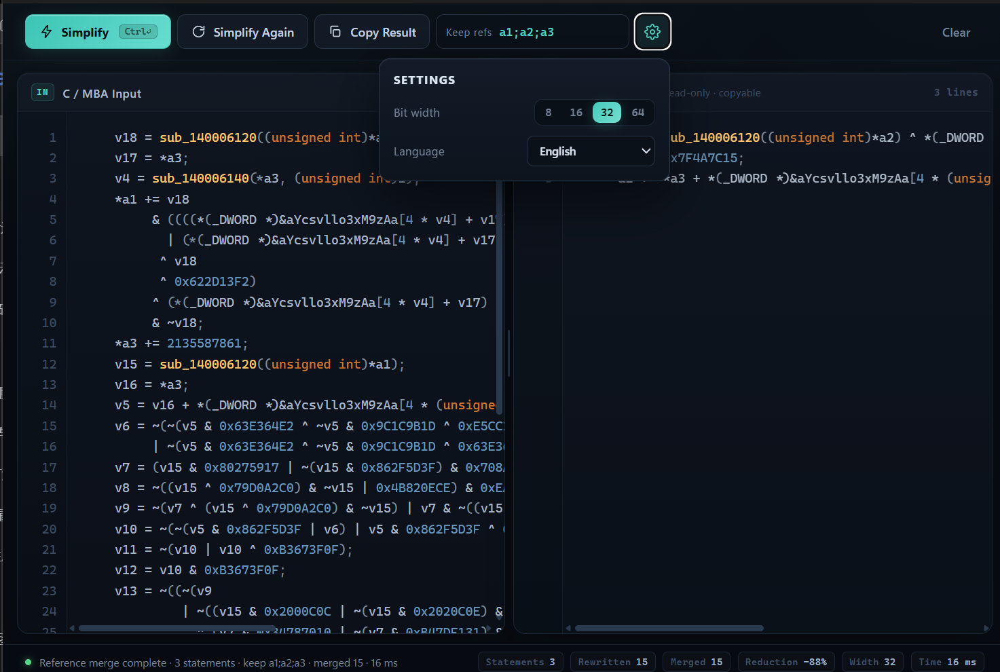
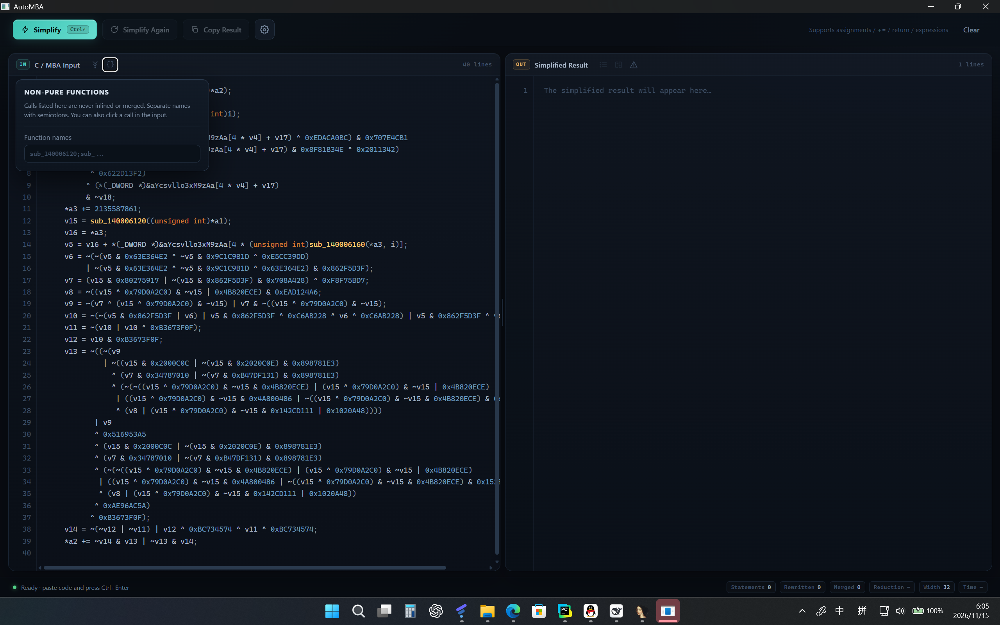

# AutoMBA

**English** | [简体中文](README.zh-CN.md)

**Version 1.0.0** · [Download Windows x64](https://github.com/MoHanFox/AutoMBA/releases/tag/v1.0.0)

A desktop MBA (Mixed Boolean-Arithmetic) deobfuscator for decompiler-style C snippets, written in Go with a WebView2 UI.

Paste C code or an MBA expression on the left; the simplified result appears on the right. The engine is inspired by GAMBA-style linear MBA decomposition and bit-level simplification, but is adapted to real decompiler output instead of single expressions.



## Features

- **Dark two-pane IDE UI** with CLion/Darcula syntax highlighting.
- **MBA simplification**: arithmetic identities, term merging, exact bit-level ANF, bit-slice truth tables and optimal Boolean formulas for small atom sets.
- **Simplification modes**: normal, simplify-again and dataflow-aware deep mode.
- **Root-variable merge**: use the root-variable icon next to **C / MBA Input** to keep roots such as `a1;a2;a3`; local scalar definitions are merged into statements that write those roots.
- **Preserve side effects**: keep call/load temporaries instead of aggressively inlining them.
- **Non-pure call annotations**: use the function icon next to **C / MBA Input** to list calls that must never be inlined, for example `sub_1;sub_2`.
- **Click-to-annotate**: click a variable or function name in the input editor to toggle it as a root variable or a non-pure function.
- **Auto simplify**: debounce input and simplify automatically.
- **Dead code elimination**: remove pure scalar assignments whose values are never used later.
- **Cross-statement CSE**: materialize repeated pure subexpressions that are stable between their first and last use.
- **Signed arithmetic**: explicit signed semantics for arithmetic right shift, negative division/modulo and comparisons.
- **Extended C expressions**: ternary `?:`, comparison/logical operators, casts, member access, indexing and pointer arithmetic.
- **Equivalence modes**: `None`, `Sampled` deterministic differential execution, or `Z3 / SMT` proof via an external z3 executable.
- **Diff view, warnings panel and simplification steps**: inspect line changes, warnings and per-statement before/after reasons.
- **Click a variable** in the input or result to see where it came from and how it changed.
- **Persistent settings** in `config.json` next to the executable.

## Requirements

- Windows 10/11 with WebView2 Runtime.
- Go 1.24 or newer.
- MinGW-w64 GCC for CGO builds (tested with GCC 16.2.0).
- A WebView2 profile directory next to the executable (`.webview`); the app sets `WEBVIEW2_USER_DATA_FOLDER` automatically.

## Build

```powershell
.\build.bat
```

This produces:

- `AutoMBA.exe` — GUI build (`-H=windowsgui`).
- `automba-cli.exe` — console/CLI build.

Manual build:

```powershell
go build -trimpath -ldflags "-s -w -H=windowsgui" -o AutoMBA.exe .
go build -trimpath -ldflags "-s -w" -o automba-cli.exe .
```

If the Go module proxy is unreachable, use:

```powershell
$env:GOPROXY = "https://goproxy.cn,direct"
```

## Usage

### GUI

1. Paste decompiled C code or an MBA expression into **C / MBA Input**.
2. Click **Simplify** (or **Simplify Again** to iterate).
3. Use the root-variable and function icons next to **C / MBA Input** to set root variables and non-pure calls. Clicking a variable or function name in the input also lets you toggle the same annotation.
4. Click the gear to configure width, language, equivalence mode and the remaining analysis options.



The result header contains three tools:

- **Steps** — per-statement before/after transformation trace with a reason.
- **Diff** — side-by-side original/simplified line diff.
- **Warnings** — verification status and simplification warnings, shown as an inline overlay over the result panel.

Variables are clickable in both editors. The popover shows the source expression, the simplified form, the source line and the reason.

### CLI

```powershell
Get-Content examples\sample.c -Raw | .\automba-cli.exe -cli -w 32 -keep "a1;a2;a3"
```

Flags:

| Flag | Meaning |
| --- | --- |
| `-cli` | Read C from stdin, print the result and exit. |
| `-w 32` | Bit width: `8`, `16`, `32` or `64`. |
| `-deep` | Use dataflow-aware deep simplification. |
| `-keep "a1;a2;a3"` | Enable root-variable merge for these roots. |
| `-verify-mode none\|sampled\|z3` | Equivalence mode. |
| `-z3 "C:\Python313"` | Z3 executable, Python root, or Z3 directory. |
| `-verify` | Deprecated shorthand for `-verify-mode sampled`. |
| `-preserve` | Keep call/load temporaries to preserve side effects. |
| `-dead` | Remove dead pure scalar assignments. |
| `-cse` | Eliminate repeated pure subexpressions. |
| `-extended` | Simplify ternary/comparison/logical expressions (default `true`). |
| `-signed` | Use signed `>>`, `/`, `%` and comparisons (default `true`). |
| `-impure "sub_1;sub_2"` | Calls that must never be inlined. |

Example:

```powershell
Get-Content examples\sample.c -Raw |
  .\automba-cli.exe -cli -w 32 -keep "a1;a2;a3" -preserve -verify-mode sampled -signed
```

## Settings and `config.json`

Settings are stored in `config.json` next to `AutoMBA.exe`:

```json
{
  "width": 32,
  "language": "en",
  "verifyMode": "none",
  "preserveSideEffects": false,
  "autoSimplify": false,
  "deadCode": false,
  "extendedC": true,
  "signed": true,
  "cse": false
}
```

Root variables and non-pure function lists are **session-only**; they are intentionally not written to `config.json`. An empty `z3Path` is omitted too.

- `width`: `8`, `16`, `32` or `64`, default `32`.
- `language`: `en` (English, default) or `zh` (Simplified Chinese).
- `verifyMode`: `none`, `sampled` or `z3`.
- `z3Path`: optional Z3 executable, Python root, or Z3 directory used by Z3 mode.
- `preserveSideEffects`: keep call/memory-read temporaries during root-variable merge.
- `autoSimplify`: simplify automatically after typing stops.
- `deadCode`: remove unused pure scalar assignments.
- `extendedC`: simplify ternary/comparison/logical expressions.
- `signed`: signed semantics for right shift, division, modulo and comparisons.
- `cse`: cross-statement common subexpression elimination.

## Semantics and limitations

### Signed arithmetic

Bitwise operations and `+`, `-`, `*` are width-agnostic two's-complement operations. Signed mode additionally affects:

- `>>`: arithmetic (sign-propagating) right shift.
- `/` and `%`: C-style truncation toward zero for negative operands.
- `<`, `<=`, `>`, `>=`: signed comparisons.

Turning signed mode off uses unsigned semantics for those operators.

### Extended C expressions

The parser supports ternary `?:`, comparison and logical operators, casts, member access, array indexing and pointer arithmetic. Unsupported or opaque operations are preserved as atoms rather than dropped. When **Extended C expressions** is off, ternary/comparison/logical operators are kept conservative and are not folded.

### Root-variable merge and side effects

Root-variable merge is dataflow-oriented. By default, calls and memory reads may be inlined or duplicated. This is useful for algebraic analysis but does not guarantee the original evaluation order or call count.

Enable **Preserve side effects** to keep call/load results in temporaries. Calls listed under the function icon (**Non-pure functions**) are never inlined, even in aggressive mode.

### CSE and dead code

- **Dead code elimination** only removes pure scalar assignments that are not used later. Calls and memory reads are retained because they may have side effects.
- **CSE** only considers pure subexpressions that occur at least twice and are stable (their input variables are not assigned between first and last use). It inserts width-appropriate temporaries such as `int __cse1` or `unsigned int __cse1`.

### Equivalence check

The **Equivalence** dropdown has three modes:

- **None** — skip verification.
- **Sampled** — execute the original and simplified programs over 256 deterministic samples. Calls and memory loads are modeled as deterministic external values. This is a strong sanity check, **not a formal proof**.
- **Z3 / SMT** — export a QF_AUFBV SMT-LIB script and invoke Z3. Calls, array loads and pointer dereferences become uninterpreted functions; `if/else` is merged with `ite`, and member access (`s.x`, `p->x`) is modeled as a symbolic memory cell. `switch` cases with a trailing `break` are lowered to guarded branches. `while`/`for`/`do` are unrolled to a bounded number of iterations and reported as **bounded**, not as a full proof. `goto`, `return`, `continue`, loop-`break` and `switch` fallthrough are still reported as `skipped`. If Z3 is not installed, verification reports `skipped` with an instruction instead of silently falling back.

### Installing Z3 and selecting the path

Z3 is not bundled. Install either a Z3 executable or the Python `z3-solver` package:

```powershell
py -3.13 -m pip install z3-solver
```

Then in **Settings → Equivalence check → Z3 / SMT**, a **Z3 path** row appears:

- click the folder icon to choose a Python root (the folder containing `python.exe`) or a Z3 directory;
- click the file icon to choose `z3.exe` or `python.exe` directly;
- the path can also be typed manually.

Accepted path forms:

- a `z3.exe` / `z3` executable;
- a Z3 installation directory containing `z3.exe` or `bin/z3.exe`;
- a Python installation root containing `python.exe` with `z3-solver` installed;
- a Python installation's `bin` or `Scripts` directory.

If the path is empty, the app still tries `PATH`, `Z3_EXE`, `z3.exe` next to the app, and Python installations on `PATH`. The selected path is saved as `z3Path`; an empty path is not written to `config.json`.

CLI equivalent:

```powershell
Get-Content examples\sample.c -Raw |
  .\automba-cli.exe -cli -w 32 -keep "a1;a2;a3" -verify-mode z3 -z3 "C:\Python313"
```

`goto`, `return`, `continue`, loop-`break` and other unsupported constructs cause Z3 mode to report `skipped` with a clear message. Loops that are unrolled are reported as `bounded`.

### What "equivalent" means when functions are unknown

For a call such as `sub_theFuncYouAdd(x)`, Z3 cannot know the function body. The verifier therefore declares it as an **uninterpreted function (UF)**:

- the same function with the same argument values returns the same result;
- different arguments may return arbitrary results;
- the result does not depend on globals, memory, aliasing or hidden state;
- the call has no side effects that must be preserved.

The proof is therefore **conditional**: it proves value equivalence for every pure, deterministic implementation of the named functions. It does **not** prove that the original binary functions behave that way. If a function reads/writes globals, mutates memory, depends on aliasing, or is non-deterministic, the proof may be invalid. Use the non-pure function list and "Preserve side effects" for such calls, and use binary-level symbolic execution or differential testing when actual binary semantics must be established.

Loops are also bounded rather than universally proved: `while`/`for`/`do` are unrolled a fixed number of times. A `bounded` result covers only executions within that bound. Arbitrary loop/goto equivalence is undecidable in general and requires invariants or a CFG analysis.

## Example

Input excerpt:

```c
a1 = ((~v17 & 0x780080C0 | v17 & 0x1D02200 | 0x2280110) ^ 0xFC07DCEF) & 0xA0512020;
y = a1 + 1 ^ 0xFF;
```

With `y` added into root variables:

```c
y = (v17 & 0x20502000 ^ 0x80010020) + 1 ^ 0xFF;
```

## Project layout

```text
main.go                 WebView entry, bindings, CLI
config.go               config.json persistence
internal/mba/           parser, simplifier, passes and verifier
  lexer.go              C lexer
  parser.go             Pratt expression parser
  simplify.go           arithmetic/bitwise simplifier
  bitwise.go            ANF and bit-slice candidates
  bitslice.go           optimal Boolean tables
  refs.go               reference merge and purity handling
  deep.go               cross-statement propagation
  process.go            statement-level processing
  postpass.go           DCE and CSE
  verify_code.go        sampled differential verifier
  smt.go                Z3/SMT-LIB exporter and runner
  smt_flow.go           if/else and member-access Z3 front end
  analysis.go           definitions and step trace
web/index.html          UI, i18n and syntax highlighting
docs/                   screenshots
examples/               sample input
```

## Tests

```powershell
go test ./...
```

## License

[MIT](LICENSE) © 2026 MoHanFox
