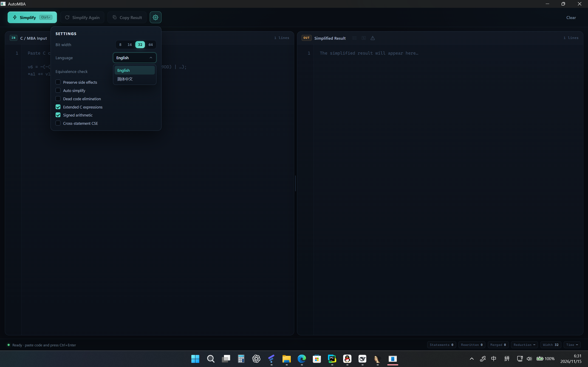

# AutoMBA

[English](README.md) | **简体中文**

一个用 Go + WebView2 编写的桌面版 MBA（Mixed Boolean-Arithmetic，混合布尔算术）反混淆器。

左侧粘贴反编译风格的 C 代码或 MBA 表达式，右侧得到化简结果。算法参考 GAMBA 的线性 MBA 分解和位级化简，但针对反编译代码片段做了适配。



## 功能

- 深色双栏 IDE 界面，CLion/Darcula 风格 C 语法高亮。
- MBA 化简：算术恒等式、项合并、精确位级 ANF、位切片真值表和少量变量的最优布尔公式。
- 化简模式：普通、再次化简、跨语句数据流深层化简。
- 根变量合并：在输入面板的根变量图标中设置 `a1;a2;a3`，把局部标量定义合并到写入这些根变量的语句。
- 保持副作用：保留调用/内存读取临时变量，避免激进内联改变求值顺序。
- 非纯函数标注：在函数图标中列出不允许内联的调用，例如 `sub_140006120;sub_140006140`。
- 点击标注：在输入区点击真实变量或函数调用，可直接勾选“保持为根变量”或“标记为非纯函数”；点击的 token 会高亮。
- 自动简化：停止输入后自动执行化简。
- 死代码删除：删除之后不再使用的纯标量赋值。
- 跨语句 CSE：把稳定且重复出现的纯子表达式提取为临时变量。
- 有符号算术：算术右移、负数除法/取模、比较运算使用显式有符号语义。
- 完整 C 表达式：`?:`、比较/逻辑运算、复杂 cast、成员访问、数组下标、指针算术。
- 等价性检查：`None`、`Sampled` 抽样差分、`Z3 / SMT` 形式化证明。
- Diff、警告面板、化简步骤：结果标题旁的图标可查看行级差异、警告/验证状态和逐语句前后变化。
- 设置持久化到程序目录的 `config.json`。

## 环境要求

- Windows 10/11 + WebView2 Runtime。
- Go 1.24 或更新版本。
- CGO 构建需要 MinGW-w64 GCC（测试使用 GCC 16.2.0）。
- Z3 模式需要以下任意一种：
  - `PATH` 中的 `z3` / `z3.exe`
  - `Z3_EXE` 指向 Z3 可执行文件
  - 程序目录下的 `z3.exe`
  - Python 的 `z3-solver` 模块（支持 `py -3.15`、`py -3.14`、`py -3.13`、`py -3`、`python`）

## 构建

```powershell
.\build.bat
```

生成：

- `AutoMBA.exe`：GUI 构建（`-H=windowsgui`）
- `automba-cli.exe`：命令行构建

手动构建：

```powershell
go build -trimpath -ldflags "-s -w -H=windowsgui" -o AutoMBA.exe .
go build -trimpath -ldflags "-s -w" -o automba-cli.exe .
```

如果 Go 模块代理不可达：

```powershell
$env:GOPROXY = "https://goproxy.cn,direct"
```

## 使用

### GUI

1. 在 **C / MBA Input** 中粘贴 C 代码或 MBA 表达式。
2. 点击 **Simplify**，或 **Simplify Again** 迭代化简。
3. 使用输入标题旁的根变量和函数图标设置根变量与非纯函数；也可以直接点击输入中的变量/函数调用。
4. 点击齿轮设置位宽、语言、等价性检查和其他分析选项。

结果标题旁有三个工具：

- **Steps**：逐语句的 `before → after` 和原因。
- **Diff**：原始代码与化简结果的左右对照。
- **Warnings**：验证状态和化简警告，在结果面板内部显示。

### CLI

```powershell
Get-Content examples\sample.c -Raw | .\automba-cli.exe -cli -w 32 -keep "a1;a2;a3"
```

| 参数 | 含义 |
| --- | --- |
| `-cli` | 从 stdin 读取 C，输出结果后退出 |
| `-w 32` | 位宽：8 / 16 / 32 / 64 |
| `-deep` | 数据流深层化简 |
| `-keep "a1;a2;a3"` | 根变量合并 |
| `-verify-mode none\|sampled\|z3` | 等价性检查模式 |
| `-verify` | 已弃用，等价于 `-verify-mode sampled` |
| `-preserve` | 保留调用/读取临时变量 |
| `-dead` | 删除死代码 |
| `-cse` | 跨语句公共子表达式消除 |
| `-extended` | 化简三元/比较/逻辑表达式（默认 true） |
| `-signed` | 右移/除法/取模/比较使用有符号语义（默认 true） |
| `-impure "sub_...;sub_..."` | 不允许内联的调用 |

## 配置

`config.json` 位于 `AutoMBA.exe` 同目录：

```json
{
  "width": 32,
  "language": "en",
  "verifyMode": "none",
  "roots": "",
  "preserveSideEffects": false,
  "autoSimplify": false,
  "deadCode": false,
  "extendedC": true,
  "signed": true,
  "cse": false,
  "impureCalls": ""
}
```

- `width`：位宽。
- `language`：`en` 或 `zh`。
- `verifyMode`：`none`、`sampled` 或 `z3`。
- `roots`：根变量列表，例如 `a1;a2;a3`。
- `preserveSideEffects`：保留调用/读取临时变量。
- `autoSimplify`：自动简化。
- `deadCode`：死代码删除。
- `extendedC`：完整 C 表达式化简。
- `signed`：有符号算术。
- `cse`：跨语句 CSE。
- `impureCalls`：非纯函数列表。

## 语义与限制

### 有符号算术

位运算和 `+`、`-`、`*` 使用二补码语义。有符号模式额外影响：

- `>>`：算术右移。
- `/`、`%`：负数按 C 的向零截断。
- `<`、`<=`、`>`、`>=`：有符号比较。

关闭后使用无符号语义。

### 完整 C 表达式

支持 `?:`、比较/逻辑运算、cast、成员访问、数组下标和指针算术。无法处理的构造会保留为原子，而不是丢弃。

### 根变量合并与副作用

默认情况下调用和内存读取可能被内联或复制，适合代数分析，但不保证原程序的求值顺序/次数。开启“保持副作用”后，会保留调用/读取临时变量；列在非纯函数列表中的调用永远不会被内联。

### CSE 与死代码

- 死代码删除只删除纯标量赋值；调用和内存读取会保留。
- CSE 只处理出现至少两次、且首末使用之间输入变量未被修改的纯子表达式，并生成位宽合适的临时变量。

### 等价性检查

- **None**：不检查。
- **Sampled**：256 组确定性抽样差分执行。调用和内存读取建模为确定性外部值；这是强抽样检查，不是形式化证明。
- **Z3 / SMT**：导出 QF_AUFBV SMT-LIB 并调用 Z3。调用、数组读取和指针解引用使用未解释函数；`if/else` 使用 `ite` 合并；成员访问（`s.x`、`p->x`）建模为符号内存单元。
- Z3 模式目前支持直线赋值、`if/else`、成员访问、cast、调用和数组读取；`while`、`for`、`switch`、`goto`、`return` 等会明确标记为 `skipped`。
- Z3 证明基于“调用是纯函数”的假设，不建模调用的副作用。

## 项目结构

```text
main.go                 WebView 入口、绑定、CLI
config.go               config.json 持久化
internal/mba/           lexer、parser、化简、验证
  refs.go               根变量合并与非纯函数
  deep.go               跨语句传播
  process.go            语句处理
  postpass.go           DCE 与 CSE
  verify_code.go        抽样差分验证
  smt.go                Z3/SMT-LIB 导出与调用
  smt_flow.go           if/else、成员访问的 Z3 前端
  analysis.go           定义来源与步骤
web/index.html          UI、i18n、语法高亮
docs/                   截图
examples/               示例输入
```

## 测试

```powershell
go test ./...
```

Z3 测试会在没有 Z3 后端时自动跳过。

## 许可证

[MIT](LICENSE) © 2026 MoHanFox
